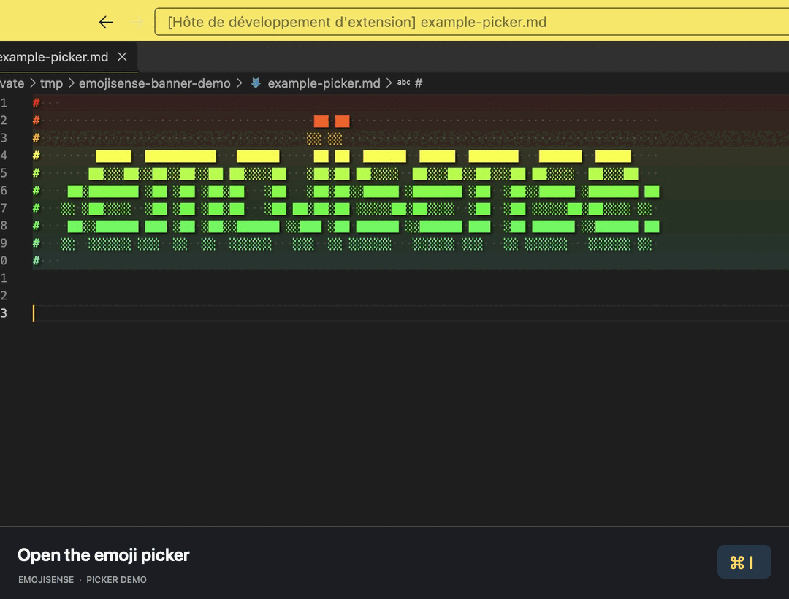

# :emojisense:

Adds suggestions and autocomplete for emoji to VS Code.


Inspired by the [Atom autocomplete+ emojis suggestions plugin][atom].

## Features

- :smile: Quickly **insert emoji** using the `:smile:` syntax supported by Github and many other sites
- :symbols: **Insert emoji markup** by typing `::`
- :gear: Enable and control **emoji completion settings** per language
- :eyes: See **emoji previews** of `:smile:` style markup inline
- :memo: Can be enabled in VS Code's SCM (git) input box.
- :mag: Provide an **emoji picker** to select and insert an emoji in the editor or terminal.
  - To access the picker, run the `Emojisense: Pick an emoji` command, or use the default keybindings:
    - Mac: <kbd>cmd</kbd> + <kbd>i</kbd>
    - Linux: <kbd>ctrl</kbd> + <kbd>alt</kbd> + <kbd>i</kbd>
    - Windows: <kbd>ctrl</kbd> + <kbd>i</kbd>
  - To access the **emoji-code picker** and insert `:emoji:` markup in the editor or terminal, run the `Emojisense: Pick an :emoji:` command, or use the default keybindings:
    - Mac: <kbd>shift</kbd> + <kbd>cmd</kbd> + <kbd>i</kbd>
    - Linux: <kbd>shift</kbd> + <kbd>ctrl</kbd> + <kbd>i</kbd> in the editor; add <kbd>alt</kbd> in the terminal
    - Windows: <kbd>shift</kbd> + <kbd>ctrl</kbd> + <kbd>i</kbd>
  - :currency_exchange: While the picker is open, use its insertion-mode button to switch between emoji and `:shortcode:` output, or press <kbd>shift</kbd> + <kbd>cmd</kbd> + <kbd>i</kbd> on macOS, <kbd>shift</kbd> + <kbd>ctrl</kbd> + <kbd>alt</kbd> + <kbd>i</kbd> on Linux, or <kbd>shift</kbd> + <kbd>ctrl</kbd> + <kbd>i</kbd> on Windows. The title shows the current mode. Switching preserves your search and selection, and each opening starts in the mode of the command you used.
  - :clipboard: Copy the highlighted item using <kbd>cmd</kbd> + <kbd>c</kbd> on macOS or <kbd>ctrl</kbd> + <kbd>c</kbd> on Windows/Linux, or click an item's copy button to copy that item. This copies emoji or `:shortcode:` according to the current insertion mode, keeps the picker open, and leaves insertion history unchanged. In this picker, the shortcut copies the highlighted item rather than selected search text.
  - :white_check_mark: Successful copying briefly changes that item's copy icon to a checkmark, with a tooltip showing what was copied. The copy icon returns after one second. Clipboard failures show a warning so you can retry.
  - :scroll: The emoji and shortcode pickers share the last 200 successfully inserted shortcodes, most recent first, across editors, terminals, and workspaces. History persists across restarts in the current VS Code profile. Exact and prefix preferences take priority while searching; clearing the search restores recent history order. A history storage failure does not interrupt insertion.

:open_book: [List of supported emoji][cheat]



## General Configuration

- `emojisense.unicodeCompletionsEnabled`: Enable completions that insert emoji as unicode, i.e. `:smile_cat:` -> 😸

- `emojisense.markupCompletionsEnabled`: Enable completions that insert emoji markup, i.e. `::smile_cat` -> `:smile_cat:`

- `emojisense.showOnColon`: Should emoji completions automatically be shown when you type a colon? Enabled by default. If you disable `showOnColon`, it is recommended that you have `quickSuggestions` enabled.

- `emojisense.emojiDecoratorsEnabled`: Show emoji decorators inline for `:smile_cat:` markup in a file? Enabled by default in markdown.

## Picker Configuration

- `emojisense.picker.ignoreSpaces`: Ignore literal space characters when matching in either picker (for example, `s mile` matches `smile`), while preserving the text you type. Enabled by default. Tabs and other whitespace characters are not ignored. Set this to `false` to use native filtering alone. Native matches keep their highlighting; additional matches found by ignoring spaces may have no blue highlighting.

- `emojisense.picker.searchDescriptions`: Show and search human-readable descriptions and tags in both pickers (for example, `grinning face with big eyes · #happy #joy #haha`). Type `#happy` to match tags using native filtering, or `happy` for a broader search. Combine tags and text in either order (`#happy face` or `face #happy`); all tag terms and the text must match. These additional combined matches may have no blue highlighting. Enabled by default. Displayed descriptions retain their spaces. Set this to `false` to hide descriptions and search emoji and shortcodes only. Use the description toggle in an open picker to show or hide descriptions and toggle description matching immediately; this affects only that picker, and the setting controls the default for the next opening.

- `emojisense.picker.preferExactMatch`: Rank exact shortcode matches first and automatically focus them in the emoji picker, so <kbd>Enter</kbd> selects them. Enabled by default. Names are matched without case sensitivity, with or without surrounding colons (for example, `smile` or `:smile:`). Other fuzzy matches remain available, and you can use the arrow keys to select another result.

- `emojisense.picker.preferPrefixMatch`: Rank shortcode prefixes ahead of other fuzzy matches. Enabled by default. For example, `smile` ranks the single exact match `smile` first, then `smile_cat`, then fuzzy matches such as `sweat_smile`. Set both match preferences to `false` to disable prioritization. Set `ignoreSpaces` to `false` too to disable space-insensitive matching. Shared recent history still appears first.

## Per Language Configuration

*Emojisense* is enabled by default in markdown, git commits, and plaintext files. You can enable it in other languages using `"emojisense.languages"`

```jsonc
"emojisense.languages": {
    "markdown": true,
    "plaintext": false,
    "json": true,
    "scminput": true // language used in the source control commit message box
}
```

The language keys here come from [VS Code's list of language identifiers](https://code.visualstudio.com/docs/languages/identifiers).

You can also change the settings for each language. Here's the default emojisense configuration for example:

```jsonc
"emojisense.languages": {
    "markdown": true,
    "plaintext": {
        "markupCompletionsEnabled": false,
        "emojiDecoratorsEnabled": false
    },
    "scminput": true // language used in the source control commit message box
}
```

Whenever a value is left unspecified, the top level setting is used instead. In this case, markdown files will fallback to use the top level `emojisense.unicodeCompletionsEnabled` and `emojisense.markupCompletionsEnabled` settings, while plaintext files will have `markupCompletionsEnabled` disabled and fallback to the `emojisense.unicodeCompletionsEnabled` setting.

You can enable emojisense for all languages using `*`:

```jsonc
"emojisense.languages": {
    "*scminput*": true
}
```

## Development

Run `npm ci`, then `npm test` to run the picker regression tests. The tests exercise the TypeScript implementation with mocked VS Code APIs, covering exact and prefix preferences, candidate retention, and editor/terminal insertion. Native VS Code filtering and rendering require a separate extension-host check.

## Credits

- Icon from emojione: https://www.emojione.com
- [Atom autocomplete+ emojis suggestions plugin][atom]


[atom]: https://atom.io/packages/autocomplete-emojis
[cheat]: https://github.com/ikatyang/emoji-cheat-sheet
