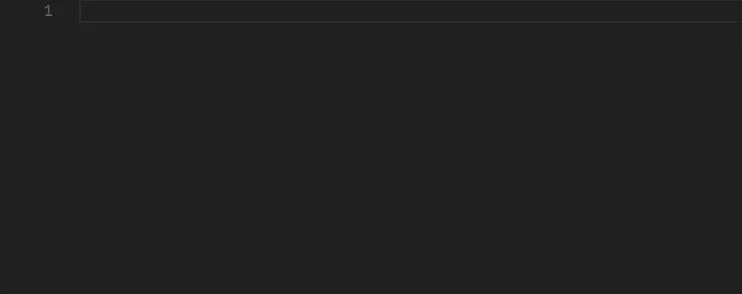

Adds suggestions and autocomplete for emoji to VS Code.



Inspired by the [Atom autocomplete+ emojis suggestions plugin][atom].

## Features

- Quickly insert emoji using the `:smile:` syntax supported by Github and many other sites
- Insert emoji markup by typing `::`
- Enable and control emoji completion settings per language
- See emoji previews of `:smile:` style markup inline
- Can be enabled in VS Code's SCM (git) input box.
- Provide an emoji picker to select and insert an emoji in the editor or terminal. To access the picker, run the `Emojisense: Pick an emoji` command, or use the default keybindings:
    - Mac: <kbd>cmd</kbd> + <kbd>i</kbd>
    - Linux: <kbd>ctrl</kbd> + <kbd>alt</kbd> + <kbd>i</kbd>
    - Windows: <kbd>ctrl</kbd> + <kbd>i</kbd>
- The emoji and shortcode pickers share the last 200 successfully inserted shortcodes, most recent first, across editors, terminals, and workspaces. History persists across restarts in the current VS Code profile. Exact and prefix preferences take priority while searching; clearing the search restores recent history order. A history storage failure does not interrupt insertion.

[List of supported emoji][cheat]

## General Configuration

- `emojisense.picker.ignoreSpaces`: Remove literal space characters from input as you type in either picker (for example, `s mile` becomes `smile`). Enabled by default. VS Code's native filtering searches the resulting text. Tabs and other whitespace characters are preserved. Set this to `false` to keep spaces in your queries, including description phrases.

- `emojisense.picker.searchDescriptions`: Show and search human-readable descriptions in both pickers (for example, `grinning face with smiling eyes`). Enabled by default. Displayed descriptions retain their spaces. Set this to `false` to hide descriptions and search emoji and shortcodes only. Exact and prefix preferences continue to apply to shortcode names.

- `emojisense.picker.preferExactMatch`: Rank exact shortcode matches first and automatically focus them in the emoji picker, so Enter selects them. Enabled by default. Names are matched without case sensitivity, with or without surrounding colons (for example, `smile` or `:smile:`). Other fuzzy matches remain available, and you can use the arrow keys to select another result.

- `emojisense.picker.preferPrefixMatch`: Rank shortcode prefixes ahead of other fuzzy matches. Enabled by default. For example, `smile` ranks the single exact match `smile` first, then `smile_cat`, then fuzzy matches such as `sweat_smile`. Set both match preferences to `false` to disable prioritization. Set `ignoreSpaces` to `false` too to avoid a custom input handler. Shared recent history still appears first.

- `emojisense.unicodeCompletionsEnabled`: Enable completions that insert emoji as unicode, i.e. `:smile_cat:` -> 😸

- `emojisense.markupCompletionsEnabled`: Enable completions that insert emoji markup, i.e. `::smile_cat` -> `:smile_cat:`

- `emojisense.showOnColon`: Should emoji completions automatically be shown when you type a colon? Enabled by default. If you disable `showOnColon`, it is recommended that you have `quickSuggestions` enabled.

- `emojisense.emojiDecoratorsEnabled`: Show emoji decorators inline for `:smile_cat:` markup in a file? Enabled by default in markdown.

## Per Language Configuration

*Emojisense* is enabled by default in markdown, git commits, and plaintext files. You can enable it in other languages using `"emojisense.languages"`

```jsonc
"emojisense.languages": {
    "markdown": true,
    "plaintext": false,
    "json": true,
    "scminput": true // language used in the source control commit message box
}
```

The language keys here come from [VS Code's list of language identifiers](https://code.visualstudio.com/docs/languages/identifiers).

You can also change the settings for each language. Here's the default emojisense configuration for example:

```jsonc
"emojisense.languages": {
    "markdown": true,
    "plaintext": {
        "markupCompletionsEnabled": false,
        "emojiDecoratorsEnabled": false
    },
    "scminput": true // language used in the source control commit message box
}
```

Whenever a value is left unspecified, the top level setting is used instead. In this case, markdown files will fallback to use the top level `emojisense.unicodeCompletionsEnabled` and `emojisense.markupCompletionsEnabled` settings, while plaintext files will have `markupCompletionsEnabled` disabled and fallback to the `emojisense.unicodeCompletionsEnabled` setting.

You can enable emojisense for all languages using `*`:

```jsonc
"emojisense.languages": {
    "*scminput*": true
}
```

## Development

Run `npm ci`, then `npm test` to run the picker regression tests. The tests exercise the TypeScript implementation with mocked VS Code APIs, covering exact and prefix preferences, candidate retention, and editor/terminal insertion. Native VS Code filtering and rendering require a separate extension-host check.

## Credits

- Icon from emojione: https://www.emojione.com
- [Atom autocomplete+ emojis suggestions plugin][atom]


[atom]: https://atom.io/packages/autocomplete-emojis
[cheat]: https://www.webpagefx.com/tools/emoji-cheat-sheet/
